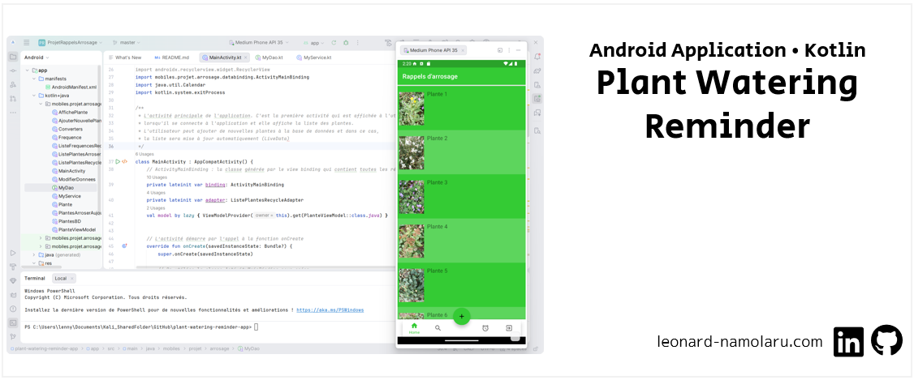

[Français](#français-application-android-kotlin-rappels-darrosage-de-plantes) • [English](#english-android-application-kotlin-plant-watering-reminder)  • [עברית](#עברית-אפליקציית-אנדרואיד-kotlin-תזכורות-להשקיית-צמחים)

### [Français] Application Android (Kotlin): Rappels d’arrosage de plantes
> :school: **Lieu de formation :** Université Paris Cité, Campus Grands Moulins (ex-Paris Diderot)
> 
> :books: **UE :** Programmation des composants mobiles
> 
> :pushpin: **Année scolaire :** M1
> 
> :calendar: **Dates :** nov. 2021 - janv. 2022
> 
> :chart_with_upwards_trend: **Note :** 15/20

#### Description
C’est un projet qui est sensé aider un amateur de fleurs et d’autres plantes à les maintenir en vie. Son problème c’est l’oubli d’arrosage pour certaines plantes et/ou l’arrosage trop fréquent pour d’autres. Il lui faut donc une application qui fait les rappels à des moments appropriés. Pour chaque plante on maintient des informations sur plusieurs fréquences d’arrosage parce que pour certaines plantes la fréquence peut dépendre de la saison, par exemple : deux fois par semaine entre mai et septembre et une fois chaque 10 jours tous les autres mois.

#### Principales fonctionnalités
- Ajout d’une nouvelle plante.
- Modification/suppression d’une plante.
- Rechercher une plante dans la liste des plantes.
- Pour chaque plante, il est possible de choisir une photo depuis la galerie du smartphone.
- Pour chaque plante, l’utilisateur a le choix entre 1 à 3 fréquences d’arrosage différentes, selon les mois de l’année.
- Une notification apparaît sur le téléphone avec la liste des plantes qui doivent être arrosées ce jour-là.
- Il est possible d’accéder à tout moment à la liste des plantes qui doivent être arrosées aujourd’hui, via le menu de l’application.
- Concernant chaque plante à arroser aujourd’hui, l’utilisateur a 2 possibilités : reporter à demain (s’il voit que l’arrosage n’est pas nécessaire), ou confirmation que l’arrosage a été effectué (alors une nouvelle alerte est programmée pour encore X jours, selon la fréquence que l’utilisateur a fixée pour chaque plante).

### [English] Android Application (Kotlin): Plant Watering Reminder

### [עברית] אפליקציית אנדרואיד (Kotlin): תזכורות להשקיית צמחים
